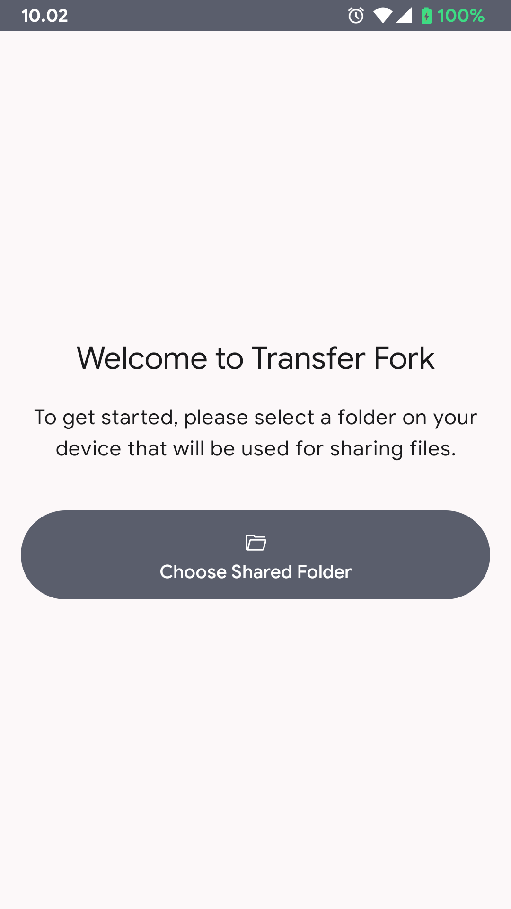
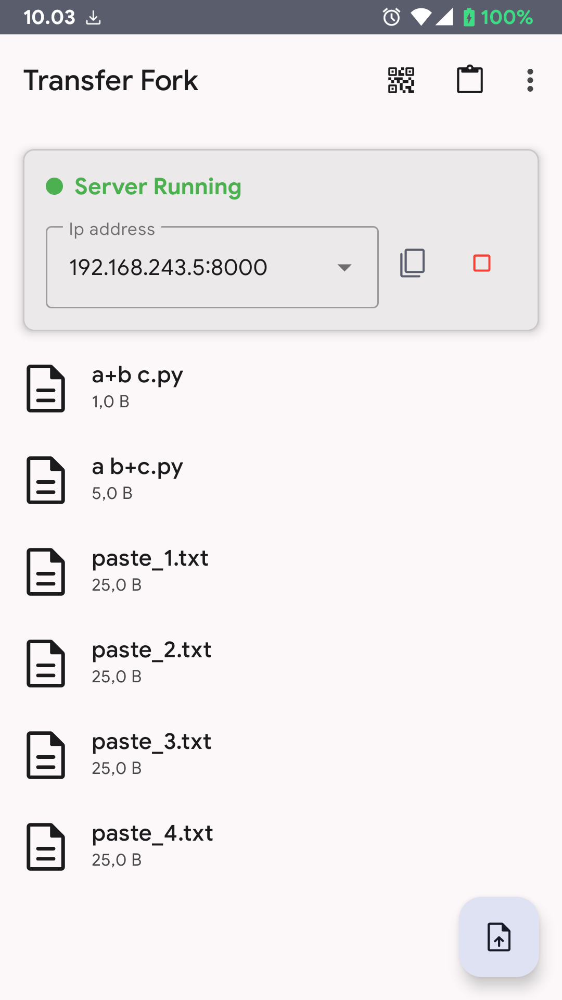
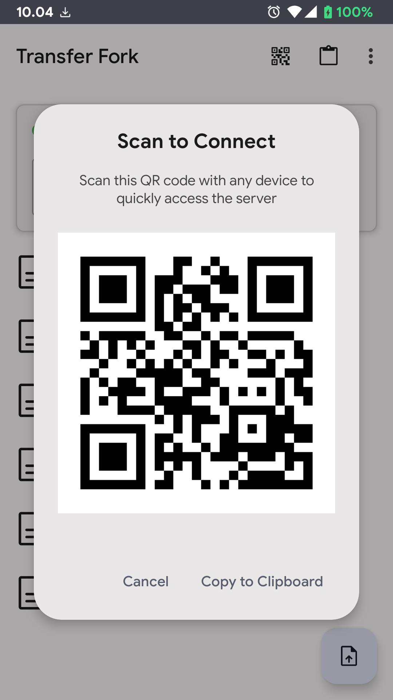
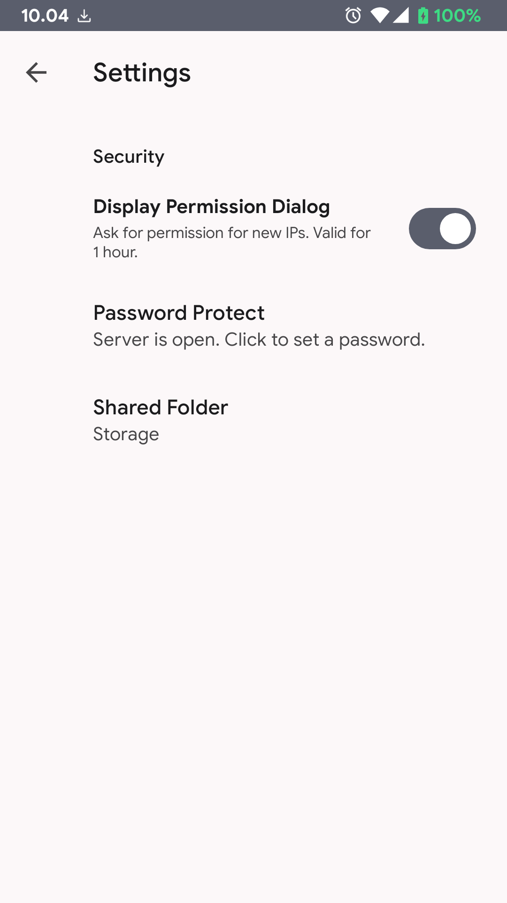
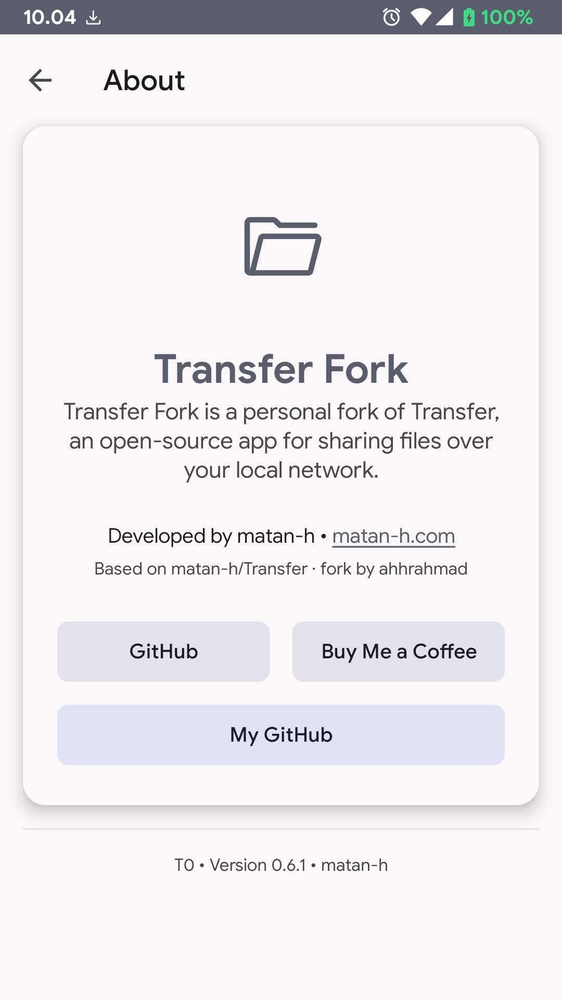
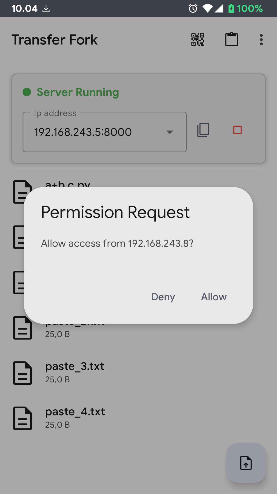

# Transfer Fork

> **Personal learning fork** of [MatanH/Transfer](https://github.com/MatanH/Transfer).
>
> Original project: <https://github.com/matan-h/Transfer>
> Original author: [matan-h](https://github.com/matan-h) (`© matan-h`, MIT license — see `LICENSE`)
>
> This is a private, non-commercial fork made for learning and personal use. It is **not affiliated
> with, endorsed by, or supported by matan-h**. It is not published to the Play Store or IzzyOnDroid;
> the only links below are the build-from-source instructions and a link to the original releases.
>
> Screenshots show this fork. See [What changed in this fork](#what-changed-in-this-fork) and
> [License and attribution](#license-and-attribution).
>
> This fork was developed with AI assistance and reviewed/tested by the repository author.


A simple local file server app for Android. Download and upload files quickly across devices over Wi-Fi — no cables, no cloud.

<table>
  <tr>
    <td>
    	
    	
    	
    	
    	
    	
    </td>
  </tr>
</table>

Transfer shares a folder over HTTP on your local network. Any device on the same Wi-Fi can open the address shown in the app using a normal web browser. Upstream describes this as an alternative to running `uploadserver` through Termux.

## The Problem It Solves

Imagine you need to transfer a file between your laptop and desktop — but you just want to send the file and move on:

* You don’t have a USB stick or cable handy
* You don’t want to configure SMB (enable/run Samba, then download a client)
* You don’t want to use the cloud — either because it’s slow, unprivate, or you simply don’t have easy access to it

## Key Features

* **Effortless LAN Sharing**: Once Transfer is active, it serves files from your chosen shared folder over HTTP. Any device on the same Wi-Fi can connect using a simple web address shown in the app.
* **Configurable Security**:
    * **IP Permissions**: By default, new devices attempting to connect trigger an "Allow/Deny" popup on your phone, giving you control over who accesses your files. This can be turned off for trusted networks.
    * **Password Protection**: For an added layer, you can secure access with a password (off by default).
* **Powerful CLI Access (curl-friendly)**:
    * Transfer works great with command-line tools. Upload files directly using `curl -T yourfile.txt <your-phone-ip>:8000`.Also,you can download files using`curl <phone-ip>:8000/yourfile.txt`.
* **Dual Browse UI**: Manage and access your shared files directly within the Transfer app on your Android device, or through the intuitive web interface on any connected computer.
* **Quick In-App Transfers**:
    * **Upload**: Easily select files from your phone’s storage to add them to the shared folder.
    * **Paste**: Paste text from your phone’s clipboard directly into a new `.txt` file in the shared folder with a single tap.

## How to get this fork

This fork is not published to app stores. Build it from source:

```bash
git clone https://github.com/ahhrahmad/Transfer.git
cd Transfer

# Requirements: JDK 21, Android SDK/NDK (see CONTRIBUTING.md), Rust 1.85+ with cargo-ndk
./gradlew assembleDebug
```

The debug APK lands at `app/build/outputs/apk/debug/app-debug.apk`.

The original, unchanged release is at [matan-h/Transfer releases](https://github.com/matan-h/Transfer/releases).

## What changed in this fork

- Package / applicationId: `com.matanh.transfer` → `com.transfer`
- HTTP core rewritten in Rust (`transfer-core/`, [axum](https://crates.io/crates/axum)), invoked from Kotlin through JNI. The original Ktor server and its dependencies (`ktor-server-*`) were removed.
- Native libraries for `arm64-v8a`, `armeabi-v7a`, and `x86_64` are built from `transfer-core/` via `cargo-ndk` (`./gradlew cargoNdk` or `assembleDebug`).
- Material You / Material 3 UI, dynamic colors, `values-v31` and `values-night-v31` themes; A12+ devices follow the wallpaper.
- New adaptive launcher icon: `folder_open` glyph (Material Symbols, Apache-2.0) on white; themed (monochrome) layer included. Setup and About layout updated to match.
- Icons replaced with Material Symbols Rounded; the Settings toggle is a Material 3 `MaterialSwitch`.
- Fixed the approved-IP cache: `ConcurrentHashMap.contains` (a legacy value check) was used instead of `containsKey`, which made the IP permission dialog reappear for every request.
- Fixed a race where a fast follow-up request could bypass both the pending-prompt wait and the approved-IP cache, freezing the Rust worker thread.
- Documentation, `CONTRIBUTING.md`, and instrumented tests updated for the fork.
- Added fork attribution and a "My GitHub" link to the About screen; the original author credit is retained.
- Instrumented tests (`AppFlowTest`) run against the Rust server; DocumentsUI interactions made locale-tolerant; 5/5 tests pass on the test device.

Known limitations compared to upstream: no release keystore is bundled (build produces an unsigned release unless you provide `KEYSTORE_*` env vars); upload support on cloud/non-seekable document providers relies on chunked streaming (no `sendfile`); this is a personal fork with no support or release cadence promised.

## Getting Started

1. Install and open Transfer on your Android device.
2. Grant necessary permissions and select a folder you wish to share (suggestion: create a new folder called `Storage` in your home directory).
3. Tap "Start Server."
4. The app will display an IP address (e.g., `http://192.168.1.X:8000`).
5. Open this address in a web browser on any other device connected to the same Wi-Fi network.
6. You're in! If IP permissions are on (default), you'll get a prompt on your phone to allow the new device.

This is the same workflow as the original app; no extra setup is required.

## FAQ
### Why does my browser show an error?
If your browser displays errors like `ERR_SSL_PROTOCOL_ERROR`, `ERR_CONNECTION_CLOSED`, or `SSL_ERROR_RX_RECORD_TOO_LONG`, it's probably because you're trying to open the site using **HTTPS** instead of **HTTP**. To fix, change the URL from `https://...` to `http://....`


### Can I set a specific IP address to use every time?
Yes, you can set a [static IP](https://junipersys.com/support/article/14695) on your Android device.

### Can I use Transfer without an internet connection?
Yes, Transfer works over your local Wi-Fi network, so an internet connection is not required. However, all devices must be connected to the same local network.

### What happens to files I share/upload to the Transfer
Transfer copy the files to the shared folder you set earlier.

### What happens if you click `T0` in the app version screen
It becomes `T1` :)

## Upstream roadmap (for reference only)

Carried over from the original README; not a roadmap for this personal fork:

- [ ] add an option to change the port in the settings
- [ ] fallback to hotspot IP in the display.
- [x] automatically update the IP when Wifi changes

## Contributing

This is a personal learning fork with no support guarantee. Issues and feedback are welcome, but pull requests may not be reviewed on any schedule. Build instructions and the module layout are documented in `CONTRIBUTING.md`.

## License and attribution

The original work and this fork remain under the MIT license; see `LICENSE` for the full text and the original copyright notice that must be retained.

Attribution and third-party notices:

* Original work: copyright (c) matan-h, [matan-h/Transfer](https://github.com/matan-h/Transfer).
* Modifications in this fork: copyright 2026 ahhrahmad, MIT-licensed.
* Icons: [Material Symbols](https://fonts.google.com/icons) (Apache License 2.0, Google LLC), used for app icon and UI glyphs.
* Rust dependencies are listed in `transfer-core/Cargo.lock`; each is distributed under MIT or Apache License 2.0 (including but not limited to `axum`, `tokio`, `jni`, `serde`, `zip`). Android app dependencies are the same versions used by upstream.

This fork is provided as-is, without warranty of any kind. It is not affiliated with or endorsed by the original author. It is a personal learning project; do not redistribute it to app stores under the name "Transfer" without the original author's permission.
